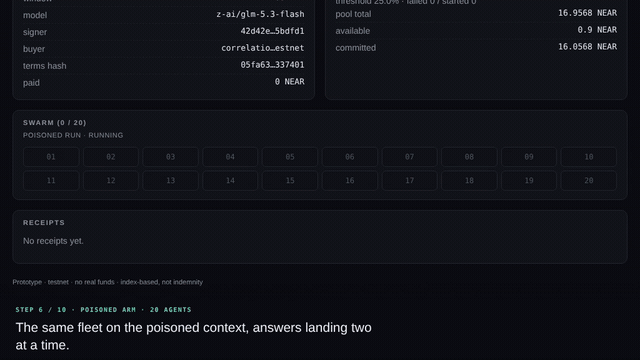

# Correlation

Parametric insurance for AI-agent swarms. A buyer pays a small premium to cover the case where
**many agents fail the same task at the same time** — the correlated failure that makes an
agent fleet useless all at once. If enough agents fail inside the policy window, the contract pays
automatically, using receipts the model provider itself signed.

The point is not that an agent failed. It is that *the swarm* failed together, and that this is
provable without trusting an oracle: the contract re-derives the expected task input, rebuilds the
signed text from the raw request and response bytes, and recovers the signer key on chain.



## Demo

The loop above is a clip of the poisoned arm. The full minute, captioned and
[posted on X](https://x.com/routebuilderdev/status/2120637879496151410), shows both arms and the payout.

## Verify it yourself

Three checks, none of which depend on this repository's scripts or on taking the README's word for
anything.

**1. Read the paying policy off the chain.** Policy 20 on `correlation.testnet` is the one the demo
paid against:

```bash
curl -s -X POST https://rpc.testnet.fastnear.com \
  -H 'Content-Type: application/json' \
  -d '{"jsonrpc":"2.0","id":1,"method":"query","params":{"request_type":"call_function","finality":"final","account_id":"correlation.testnet","method_name":"get_policy","args_base64":"eyJwb2xpY3lfaWQiOjIwfQ=="}}' \
  | python3 -c 'import sys,json; d=json.loads(bytes(json.load(sys.stdin)["result"]["result"]).decode()); print(json.dumps({k:d[k] for k in ("policy_id","status","failed","started","trigger_bps","paid_amount")}))'
```

It answers:

```json
{"policy_id": 20, "status": "Paid", "failed": 18, "started": 20, "trigger_bps": 2500, "paid_amount": "7828400000000000000000000"}
```

`paid_amount` is yoctoNEAR, so that is 7.8284 NEAR. Policy 19, the control arm, reads `Active` with
`failed: 1` — the same fleet, the same day, one sentence of context different.

**2. Open the payout transaction.**
[`861Ege…kjXf7t`](https://testnet.nearblocks.io/txns/861Ege74351hAyg95hDX6UJZw8zPPpoaN2wu6kjXf7t) is
the `claim` call the contract executed, not a transfer made by a server that decided to pay.

**3. Run the tests.** `npm test` covers canonicalisation and the API (32 tests); `cd contract &&
cargo test` covers the Rust contract (42), including a full twenty-receipt run.

## Proven on testnet

This is not a plan: policy #3 on `correlation.testnet` ran the whole path with live traffic.

| Step | Result |
|---|---|
| Twenty agents against `z-ai/glm-5.3-flash`, poisoned arm | 20 completions, 20 signed by the model TEE |
| Receipts posted | 20 accepted, 18 re-derived as failed |
| Index | 9000 bps against a 2500 bps trigger |
| `evaluate` | policy moved `Triggered` |
| `claim` | 7.8284 NEAR paid of a 7.8284 NEAR limit; pool left 0.9698 |

Every number above comes from a signed receipt: the contract rejected nothing it could not verify, and
the payout is the contract's arithmetic, not the orchestrator's claim.

The video was filmed on a later pair, and the split is not identical run to run: P-019 control (20
receipts, 1 failed, 500 bps, no payout) and P-020 poisoned (20 receipts, 18 failed, 9000 bps, 7.8284
NEAR paid, claim
[861Ege74351hAyg95hDX6UJZw8zPPpoaN2wu6kjXf7t](https://testnet.nearblocks.io/txns/861Ege74351hAyg95hDX6UJZw8zPPpoaN2wu6kjXf7t)).
Temperature 0 does not make a hosted reasoning model deterministic, so the arms are reported as
measured, never as expected.

The P-020 run is also committed, as `api/.runs/run-mwcfqpck-zq6c.json`. Every other run in that
directory is local only, but this one is checked in so the twenty-cell grid and the per-agent
receipts replay on a fresh clone with no model key: the record holds the transaction hash, the
signature and the hashes for each agent, so a reader can walk from a red cell to the chain.

Two things on screen invite a second look and are deliberate. `evaluate` runs after every arm,
including the control: the contract decides, so a below-trigger index leaves the policy `Active`. And
a receipt row shows `—` under `Tx` until its post lands, because an answer is signed before it is
written on chain.

## Quick start

```bash
npm install                                   # shared, api, web
cp .env.example .env                          # then add NEARAI_API_KEY (never committed)
npm test                                      # 32 TypeScript tests (shared + api)

./scripts/preflight.sh                        # says exactly what is missing, and how to fix it
./scripts/go.sh                               # preflight, then serve api + ui
```

`preflight.sh` reads `node_modules`, so it belongs after `npm install`. To run the two processes
separately instead of via `go.sh`:

```bash
npm run dev --workspace @correlation/api      # API on :8787
npm run dev --workspace @correlation/web      # UI on :5173
```

`go.sh` exits when a required secret is missing. That is the right behaviour before a live run, but
it stops a read-only look at the deployed contract. With a blank `.env` the two commands above still
serve the page: the policy, the pool and the index come from public RPC, and the recorded policy-20
run renders from the committed capture described under [Proven on testnet](#proven-on-testnet).

The default RPC is `https://rpc.testnet.fastnear.com`. The public `rpc.testnet.near.org` endpoint is
deprecated and answers `429` under load, which looks like a broken demo rather than a broken endpoint;
set `NEAR_RPC_URL` to move.

`preflight.sh` checks the toolchain, the contract build, every required secret, testnet RPC, each
account's existence and balance, whether the contract answers, and whether the model key is accepted
(`402`/`429` there means NEAR has not issued credits yet — retry later, nothing else is blocked).
`go.sh --capture` additionally replaces the synthetic fixture with a live one and re-runs the
contract tests.

Contract tests need the Rust 1.99 toolchain pinned in `contract/rust-toolchain.toml`:

```bash
cd contract && cargo test && cargo build --release --target wasm32-unknown-unknown
```

With the key in `.env`, one command replaces the synthetic fixture with a real, verified capture:

```bash
npm run capture --workspace @correlation/api
```

It makes one completion at policy 1 / agent index 2, verifies the signature locally, refuses to
write if the model answered wrongly or the signature is not `provider_tee`, then rewrites
`request.bin`, `response.bin`, `signature.json` and `signer.json`. After that, `cargo test` verifies
T3 against bytes the model TEE actually signed.

## The 60-second demo

1. Open `http://localhost:5173`. The page asks the contract which policy is newest and drives that
   one, so a freshly seeded policy needs no configuration; `?policy=3` pins an older one. The panel
   shows the limit, premium, 2500 bps trigger and the model `z-ai/glm-5.3-flash`. All twenty agents
   must post a receipt before the index counts at all, so a partial panel never pays out on a
   fraction of the fleet. The numbers come from what the pool actually holds: the seed script
   deposits whatever the LP account holds above a gas reserve and writes a 0.1 NEAR premium against
   a limit of 90% of the free capital. When the window has closed the run buttons disable
   themselves, because a receipt posted outside the window is rejected for the wrong reason.
2. Press **Run control**. Twenty cells fill in; the index stays at 0%, the policy stays `Active`.
3. Press **Run poisoned**. The system prompt gains one plausible-looking rounding instruction.
   In practice fifteen to eighteen of the twenty agents answer the same arithmetic question wrongly —
   the same wrong value, because the shared context does the damage, not twenty independent mistakes.
4. The index lands near 90% against a 2500 bps trigger, `evaluate` fires on chain, the policy reads
   `Triggered`, and the **Claim payout** button pays the limit to the buyer, capped by what the pool
   actually holds.

The four steps run unattended, in the order the video needs them, with `./scripts/record.sh`
(`PAUSE=1` stops between steps for filming); `./scripts/demo.sh poisoned 4` drives a single arm.

A finished run is written to `api/.runs/<run-id>.json` and served from there after the process
restarts, so the fallback in the demo script is real: if the model is unreachable on the day, poll
the recorded run id and the same UI renders the same twenty cells, bytes and signatures.

Both runs are the *same* model, the *same* prompt shape and the *same* task family. The only
difference is one sentence of context.

### What the live network does that a plan does not

Three things only showed up against the real endpoint, and each is handled in code rather than in
the demo script:

- **A completion is not always signed.** Under load NEAR AI can serve a request outside the TEE:
  the answer is fine, the signature never appears, and the chat id is gone for good. Those
  completions are asked for again (`SWARM_ATTEMPTS`, default 3) instead of being recorded as
  failures, and parallelism is kept at 2 (`SWARM_CONCURRENCY`) because more of it means more
  unsigned answers.
- **A signature appears a moment later.** The first `GET /signature/:id` legitimately 404s, so the
  verifier polls (`NEARAI_SIGNATURE_ATTEMPTS`, 10 attempts 1.5 s apart).
- **A burst of transactions collides on the nonce.** Twenty receipts in a row from one key re-read
  the same access-key nonce and get rejected as "must be larger than nonce of the used access key".
  The submitter caches one `Account` per role and retries a collision after a pause.

## Architecture

```
  orchestrator (api/)                      NEAR AI Cloud                  NEAR testnet
 ┌──────────────────────┐   exact bytes   ┌──────────────┐   signature  ┌──────────────────┐
 │ 20 agents, 2 at once │ ──────────────► │  glm-5.3     │ ───────────► │ post_receipt     │
 │ one task each        │                 │  provider TEE│              │  re-hash bytes   │
 │ keeps req/res bytes  │ ◄────────────── └──────────────┘              │  recover signer  │
 └──────────┬───────────┘                                               │  re-derive n     │
            │  request_bytes, response_bytes, signature_json            │  index = f/s     │
            └─────────────────────────────────────────────────────────► │ trigger → claim  │
                                                                        └──────────────────┘
```

The chain stores raw bytes, not a verdict, because a stored verdict is an oracle trust assumption
with extra steps. Anyone can replay a receipt offline: same bytes, same model id, same signature,
same recovery (`shared/` is a mirror of `contract/src/verify.rs`).

## What is proven

- **Signature provenance.** `signing_algo: "ecdsa"`, `signature_kind: "provider_tee"`, recovered
  key equals the registered key, and the signed text is rebuilt from the submitted bytes — so a
  receipt cannot describe a different call than the one that happened.
- **Task integrity.** The expected input is `10_000_000 + ((policy_id % 1000) * 20 + agent_index)
  % 20_000`, derived independently by the orchestrator and the contract. Submitting the wrong `n`
  fails as `E13` rather than being trusted.
- **Arithmetic.** The contract recomputes `a = n * 37 mod 1_000_003` itself; the model's answer is
  parsed, not believed.
- **One receipt per agent per policy**, enforced by a nullifier (`policy_id ‖ agent_id ‖ window
  start`), so replay is a storage read, not a policy question.
- **Payout honesty.** The pool cannot pay more than it holds; `claim` caps at available capital and
  freezes the policy NFT.

## What is NOT proven

- **Basis risk.** The index counts wrong answers on one synthetic arithmetic task. Real agent
  failures are messier: partial completions, timeouts, tool errors. This is a prototype of the
  mechanism, not of the loss distribution.
- **No loss history.** There is no actuarial model behind the premium; it is a round number chosen
  so the demo is legible, not a price.
- **TEE attestation is checked once per signer per day**, not per receipt. It answers "is this the
  model it claims to be", not "did this specific call happen".
- **Testnet only.** No real funds, no audits, no upgrade path, single pool (`pool_id = 1`).
- **The poisoned arm is staged on purpose** — that is the experiment. A production insurer would
  need a task the buyer cannot choose.

## Testnet accounts

| Role | Account | Purpose |
|---|---|---|
| contract | [`correlation.testnet`](https://testnet.nearblocks.io/address/correlation.testnet) | policies, pool, index, payouts |
| lp | `correlation-lp.testnet` | deposits capital |
| buyer | `correlation-buyer.testnet` | buys cover, claims |
| eval | `correlation-eval.testnet` | posts receipts, calls `evaluate` |

The accounts are top-level, not subaccounts: the testnet faucet only funds top-level names. The
buyer's key is also needed by the API to call `claim`, since the contract restricts payouts to the
buyer: `BUYER_ACCOUNT` and `BUYER_PRIVATE_KEY` in `.env`.

The contract is deployed and seeded on testnet. Two commands do everything, with no `near-cli`
(a dependency this machine does not have — `@near-js` is used instead):

```bash
npm run testnet --workspace @correlation/api   # create + fund accounts, deploy, write .env
npm run seed --workspace @correlation/api      # signer, pool capital, swarm, policy
```

`seed` is idempotent and derives its amounts from the LP balance, so re-running it never overspends.
It reuses a policy whose window is still open and retires one whose window has closed; `-- --new`
buys a fresh policy regardless, which is what a second demo run needs.

## Repository layout

| Path | What |
|---|---|
| `BLUEPRINT.md` | the build spec this repo follows, including every decision and its reason |
| `contract/` | Rust/serde contract: `verify`, `policy`, `pool`, `receipt`, `trigger`, `nft` |
| `contract/tests/fixtures/` | request/response bytes and a real secp256k1 signature used by both sides |
| `shared/` | canonicalisation: sha256, signed text, EIP-191 digest, derived task input |
| `api/` | exact-bytes client, local verifier, 20-agent swarm, chain submission, Fastify server |
| `web/` | one page: policy, index gauge, swarm grid, receipts |
| `spike/` | untouched standalone verifier used to capture the first real receipt |
| `scripts/` | deploy, preflight, one-command demo; signer and seeding live in `api/scripts/` |

## Tests

| Suite | Count | Covers |
|---|---|---|
| `contract` (Rust) | 42 | signature path, policy terms, pool limits, receipts (bare + envelope verdicts), index, claim, expiry, full 20-receipt run |
| `shared` | 10 | cross-language vectors pinned to the Rust fixture |
| `api` | 22 | exact bytes, required headers, verifier parity incl. error codes, HTTP states, claim, a full offline 20-agent run |

`shared` and `api` deliberately assert the *same* error codes as the contract (`E07`, `E09`, `E10`,
`E11`), so a divergence shows up as a failing test instead of a silent client-only pass.

One trap worth naming: the provider signs the **raw response body**, envelope included
(`response_hash = SHA-256(exact response-body bytes)`, per the NEAR AI docs). The contract therefore
unwraps `choices[0].message.content` itself to read the verdict, rather than asking the orchestrator
to submit extracted bytes — that would make the hash disagree with the signature.

A second trap: signed text differs by endpoint. Direct model endpoints (`*.completions.near.ai`)
sign `<model>:<req>:<resp>` and produce `provider_tee` signatures; the `cloud-api.near.ai` gateway
signs `<req>:<resp>` with no model prefix. `NEARAI_BASE_URL` therefore defaults to
`https://glm-5-3-flash.completions.near.ai/v1` (from the public list at
`completions.near.ai/endpoints`); pointing it at the gateway rejects every receipt as `E07`.

## Disclaimer

Prototype built for a hackathon. Not insurance, not a financial product, no real funds, testnet
only. Nothing here has been audited.

## License

AGPL-3.0-only — see [`LICENSE`](LICENSE). Copyright (C) 2026 Correlation contributors.

You may use, modify and self-host this software. If you run a modified version as a network
service, you must offer its source under the same license.
